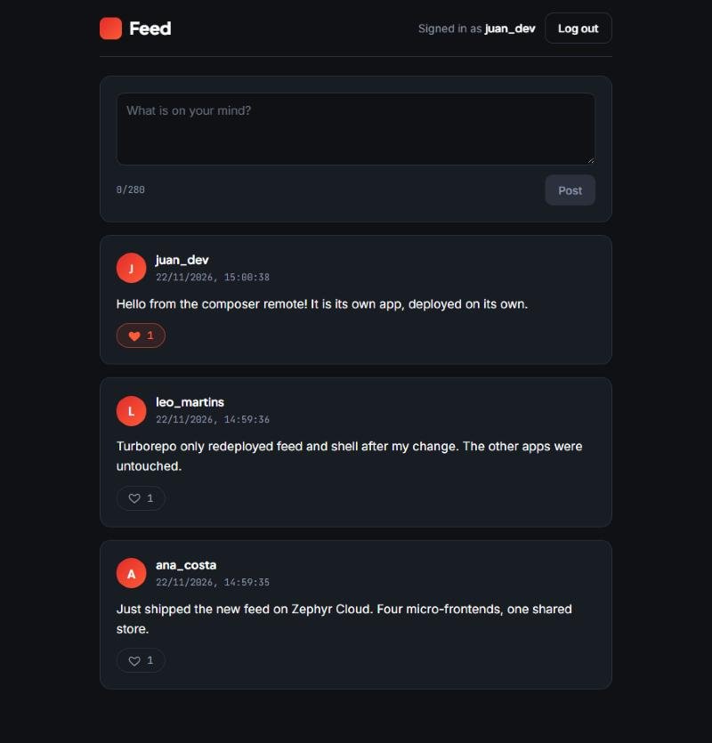
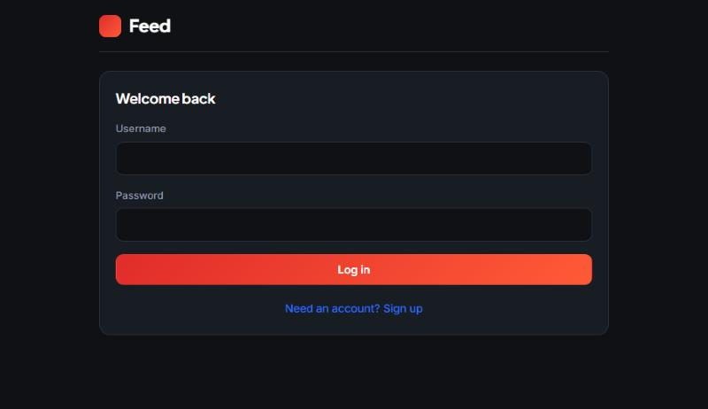
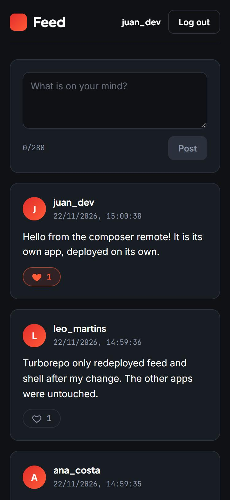
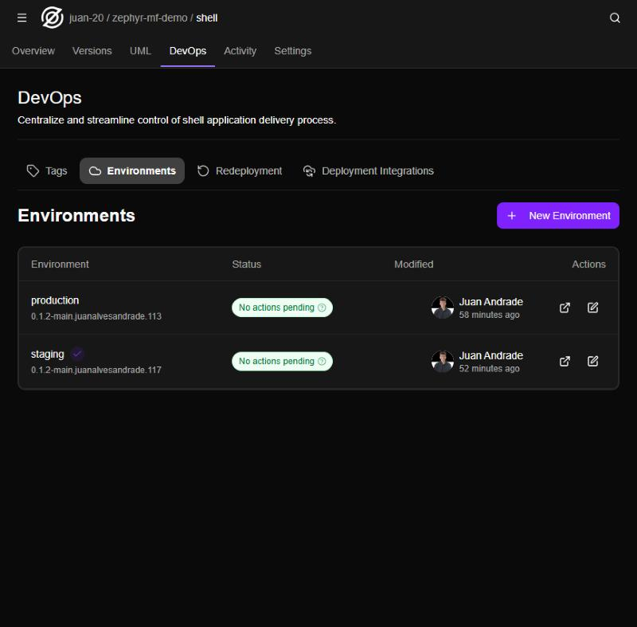
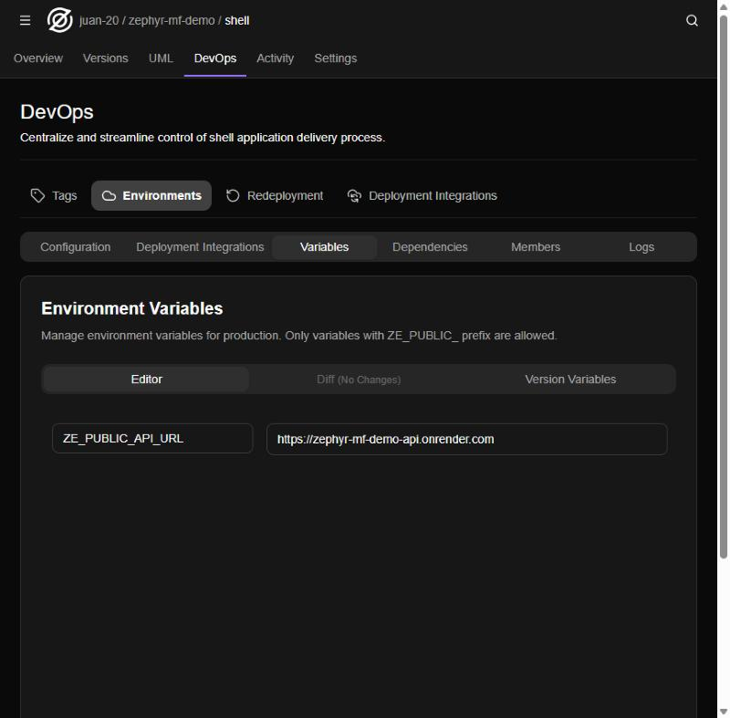
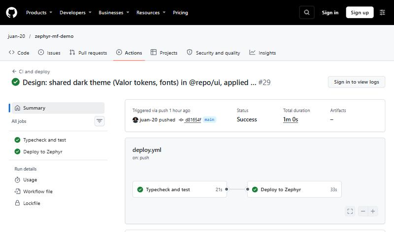

# zephyr-mf-demo

A social feed built as **micro-frontends**: log in, see the newest posts, like them and write your own. The page is assembled at runtime from four independently deployed apps, hosted on [Zephyr Cloud](https://docs.zephyr-cloud.io/), and backed by a NestJS API. The monorepo is orchestrated with Turborepo.

<p align="center">
  
</p>

## Screenshots

| Login | Feed on a phone |
|---|---|
|  |  |

## Live

| | |
|---|---|
| Production | https://production-shell-zephyr-mf-demo-juan-20-ze.zephyrcloud.app/ |
| Staging | https://staging-shell-zephyr-mf-demo-juan-20-ze.zephyrcloud.app/ |
| API (production) | https://zephyr-mf-demo-api.onrender.com |
| API (staging) | https://zephyr-mf-demo-api-staging.onrender.com |

## Contents

1. [How to run it](#how-to-run-it)
2. [Architecture](#architecture)
3. [Infrastructure](#infrastructure)
4. [Deployment logic](#deployment-logic)
5. [API](#api)
6. [Design](#design)
7. [Technical decisions](#technical-decisions)
8. [Problems solved along the way](#problems-solved-along-the-way)

---

## How to run it

### Prerequisites

- Node.js 22 and npm 10
- Git

### Start everything locally

```bash
git clone https://github.com/juan-20/zephyr-mf-demo.git
cd zephyr-mf-demo
npm install
npm run dev
```

Open http://localhost:5173, choose **Need an account? Sign up**, create a user (the password needs at least 8 characters), then write a post and like it.

`npm run dev` starts five processes through Turborepo:

| Process | Port | What it is |
|---|---|---|
| `shell` | 5173 | The host page. This is the one you open. |
| `auth` | 5174 | Remote: login form and user menu |
| `feed` | 5175 | Remote: the post list |
| `composer` | 5176 | Remote: the new-post form |
| `api` | 3000 | NestJS API, using a local SQLite file |

The dev servers are fully local. The Zephyr plugin only runs on `vite build`, so the shell loads the remotes from `localhost` and nothing is deployed. You can open a remote on its own (for example http://localhost:5175) to see its standalone preview.

### Other commands

```bash
npm test                      # API end-to-end tests and store unit tests
npm run typecheck             # TypeScript across all apps and packages
npm run dev -w api            # only the API
npm run build -w api          # compile the API
npm run start -w api          # run the compiled API
```

A local `vite build` of a frontend works without a Zephyr login, but then nothing is uploaded.

### API settings

All optional locally. Production needs `JWT_SECRET` and `DATABASE_URL`.

| Variable | Default | Purpose |
|---|---|---|
| `PORT` | `3000` | Port to listen on |
| `DATABASE_URL` | unset | Postgres connection string. When unset, the API uses SQLite. |
| `DATABASE_SSL` | on | Set to `false` to turn SSL off for Postgres |
| `SQLITE_PATH` | `dev.sqlite` | SQLite file (`:memory:` for tests) |
| `JWT_SECRET` | dev-only value | Required when `NODE_ENV=production` |
| `CORS_ORIGINS` | `localhost:5173,5174` | Comma-separated list of allowed origins |
| `CORS_ORIGIN_PATTERN` | this project's Zephyr hosts | Regular expression for allowed deploy hosts |

---

## Architecture

```
 browser ──▶ shell (host)  ──loads at runtime──▶  auth      ./LoginForm, ./UserMenu
               │  router, route guard             feed      ./Feed
               │  runtime config                  composer  ./PostComposer
               │
               └── shared singletons: react, react-dom, zustand, @repo/store
                                   │
                         one Zustand store (session + posts)
                                   │  fetch, cookie credentials
                                   ▼
                              apps/api  (NestJS + Postgres on Render)
```

| App | Role |
|---|---|
| `apps/shell` | Host: layout, hash router, route guard, loads the three remotes. |
| `apps/auth` | Remote: login and sign-up form, user menu. |
| `apps/feed` | Remote: the post list with like and unlike. |
| `apps/composer` | Remote: the "new post" form (280 characters). |
| `apps/api` | NestJS API: auth, posts, likes. |

| Package | Role |
|---|---|
| `@repo/store` | Zustand store (session and posts) plus the API client. Shared as a federation **singleton**, so every remote sees the same state. |
| `@repo/types` | `User`, `Post` and request types, shared by the API and the frontends. |
| `@repo/ui` | The theme (design tokens, fonts, component classes) and small shared components. |
| `@repo/config` | Base `tsconfig`. |

The remotes never import each other. They communicate through the store: `auth` writes the session, `composer` calls `createPost`, and `feed` re-renders from the same state. Each remote loads inside a `RemoteSlot` (an error boundary plus `Suspense`), so a failed remote shows a message with a retry button and does not take the shell down.

---

## Infrastructure

### What runs where

```
                      ┌──────────────────────── GitHub ────────────────────────┐
  git push ─────────▶ │  repository  ──▶  GitHub Actions (check, then deploy)  │
                      └───────────┬─────────────────────────────┬──────────────┘
                                  │ vite build + withZephyr()   │ push to main
                                  ▼                             ▼
                      ┌───────────────────────┐      ┌─────────────────────────┐
   browser  ◀──────── │     Zephyr Cloud      │      │          Render         │
   (static files)     │  shell  auth          │      │  API (production)       │
                      │  feed   composer      │ ───▶ │  API (staging)          │
                      │  environments + tags  │ fetch│  Postgres (production)  │
                      └───────────────────────┘      └─────────────────────────┘
```

| Component | Hosted on | Notes |
|---|---|---|
| `shell`, `auth`, `feed`, `composer` | Zephyr Cloud | Static files on Zephyr's edge network. Each app has its own versions and URLs. |
| API (production) | Render web service | `zephyr-mf-demo-api`, Node 22, health check on `/health` |
| Database (production) | Render Postgres | `zephyr-mf-demo-db`, connection string injected as `DATABASE_URL` |
| API (staging) | Render web service | `zephyr-mf-demo-api-staging`, uses a disposable SQLite file |
| CI | GitHub Actions | One workflow with a `check` and a `deploy` job |

The Render services and the database are described in [render.yaml](render.yaml), so they can be recreated from the repository with a Blueprint. Render redeploys the API on every push to `main`. Free-tier instances sleep when idle, so the first request after a pause can take about 30 seconds.

### Environments

There are two environments, each with its own Zephyr URL, API and database:

| | Staging | Production |
|---|---|---|
| Zephyr environment (shell) | `staging` | `production` |
| Zephyr tag | `staging` (`environment is staging`) | `production` (`environment is production`) |
| `ZE_PUBLIC_API_URL` | `https://zephyr-mf-demo-api-staging.onrender.com` | `https://zephyr-mf-demo-api.onrender.com` |
| API | `zephyr-mf-demo-api-staging` | `zephyr-mf-demo-api` |
| Database | SQLite file, reset on every API deploy | Postgres |
| Deployed by | every push to `main` | the manual workflow run |

<p align="center">
  
</p>

### Configuration without rebuilding

The API address is not baked into the frontend. Zephyr writes every `ZE_PUBLIC_*` variable of the build into `zephyr-manifest.json` and serves each environment's own value. At startup the shell fetches `/zephyr-manifest.json` and reads `ZE_PUBLIC_API_URL` ([runtime-config.ts](apps/shell/src/runtime-config.ts)), falling back to `localhost:3000` in local development. One build can therefore talk to the staging or the production API, and changing the address is a dashboard edit with no rebuild. These variables are public: they reach the browser, so never put secrets in `ZE_PUBLIC_*`.

<p align="center">
  
</p>

### Setting it up from scratch

1. **Zephyr.** Sign in once so the plugin can upload builds. In the `shell` app, under DevOps, create the tags `staging` and `production` (condition `environment is <name>`), the two environments tied to them, and set `ZE_PUBLIC_API_URL` on each environment.
2. **CI token.** Create a token in the Zephyr dashboard (Settings, Tokens, CI Tokens) and add it as the GitHub repository secret `ZE_CI_TOKEN`.
3. **Render.** Create a Blueprint from this repository. It creates both API services and the Postgres database, and generates `JWT_SECRET` for you.

---

## Deployment logic

### The pipeline

[.github/workflows/deploy.yml](.github/workflows/deploy.yml) has two jobs:

```
  push to main ──▶ check ──▶ deploy ──▶ Zephyr
                    │
  pull request ─────┘   (checked, never deployed)
```

- **`check`** runs on pushes and pull requests: `turbo run typecheck test`, with `.turbo` cached between runs.
- **`deploy`** runs on pushes to `main` and on manual runs, after `check` passes: `turbo run deploy --only --filter="...[<previous commit>]"`.

<p align="center">
  
</p>

### Deploy only what changed

- `shell` lists `auth`, `feed` and `composer` as dev dependencies. Zephyr resolves remote versions when the shell is built, so a remote change must rebuild the shell too. With that edge in the Turborepo graph, Turborepo orders the builds itself: the remotes first, in parallel, then the shell.
- `deploy` is its own Turborepo task with caching off. Deploying is a side effect of `vite build`, and a cached replay would skip it.
- `--only` restricts the run to the changed packages. Without it, Turborepo also runs the shell's dependencies and redeploys every remote.
- Pull requests are checked but never deployed, because the shell follows a moving tag and a deploy from an unreviewed branch could end up serving real traffic.

| Change pushed | Deployed |
|---|---|
| README or docs only | nothing |
| `feed` only | `feed`, then `shell` |
| `auth` or `composer` only | that remote, then `shell` |
| `shell` only | `shell` |
| `api` only | nothing from CI (Render redeploys the API on its own) |
| A shared package, or root files such as `turbo.json` | all four apps |

### Staging and production

- **Staging.** Every push to `main` deploys the changed apps to staging.
- **Production.** Deployed by running the workflow manually: GitHub, Actions, Run workflow, environment `production`. From the command line:

  ```bash
  gh workflow run deploy.yml -f environment=production
  ```

  Every app builds with `ZE_ENV=staging`. For the shell, `SHELL_ZE_ENV` takes over, and its Vite config maps it to `ZE_ENV`, which tells Zephyr which environment to publish to.

A guard step fails the job if `ZE_CI_TOKEN` is missing, because the Zephyr plugin only logs authentication errors and exits successfully.

### How Zephyr connects the apps

1. **`withZephyr()`** from `vite-plugin-zephyr` is the last plugin in each app's `vite.config.ts`. On `vite build` it uploads the output, creates a new version and prints that build's URL.
2. **Remote resolution.** The shell lists its remotes in `zephyr:dependencies`, by tag (`zephyr:auth@web_latest_<user>`). Zephyr creates that tag automatically and moves it to the newest CI build. At build time Zephyr resolves each remote to a real URL and records it in `zephyr-manifest.json`, and Zephyr's runtime plugin uses the manifest to replace the placeholder `localhost` entries in the bundle.
3. **The manifest** carries two things for the running page: where the remotes are, and the environment's `ZE_PUBLIC_*` values.

---

## API

NestJS with TypeORM, on Postgres (SQLite locally and in tests).

| Endpoint | |
|---|---|
| `POST /auth/register`, `POST /auth/login`, `POST /auth/logout`, `GET /auth/me` | Session. |
| `GET /posts` | The 50 newest posts, with `likeCount` and `likedByMe`. |
| `POST /posts` | Create a post (1 to 280 characters). |
| `POST /posts/:id/like`, `DELETE /posts/:id/like` | Idempotent like and unlike. |
| `GET /health` | Health check used by Render. |

Security: bcrypt password hashes, a JWT in an `HttpOnly; Secure; SameSite=None` cookie (the frontends and the API are on different sites), and one error for both unknown user and wrong password. CORS only allows localhost and this project's Zephyr hostnames, matched by a pattern ([config.ts](apps/api/src/config.ts)) with a regression test.

---

## Design

The look is a dark theme with a crimson-to-coral brand gradient, defined once in [theme.css](packages/ui/src/theme.css): color tokens, Plus Jakarta Sans for headings, Inter for text and JetBrains Mono for metadata such as timestamps and counters. The **shell loads the stylesheet once**, and the remotes only use its class names (`.btn`, `.input`, `.post`, ...). That way styling never depends on whether a remote's own CSS gets injected when it loads. Each remote also imports the theme in its standalone preview.

---

## Technical decisions

| Decision | Why |
|---|---|
| Vite 7, React 19, TypeScript | Fast setup and a Zephyr plugin. Vite 8 was avoided because `@vitejs/plugin-react` 6 requires it. |
| `@module-federation/vite` | Module Federation for Vite, supported by the Zephyr plugin. |
| One Zustand store as a singleton | The remotes stay independent but share state without a custom event bus. |
| Hash router | Deep links work on any static host without server rewrites. |
| Runtime config from the manifest | One build for staging and production, and the API URL changes without a rebuild. |
| Tag selectors for remotes | The shell follows the newest remote build. |
| npm workspaces | No extra tooling for a reviewer. |
| NestJS on Render | Zephyr hosts static frontends only, so the API needs its own host. |

---

## Problems solved along the way

| Problem | Cause and fix |
|---|---|
| `ZE10018` | No Zephyr login. Signed in interactively, then switched CI to `ZE_CI_TOKEN`. |
| `ZE10019` | The folder was not a git repository, so Zephyr guessed the organization. Creating the repository fixed it. |
| `ZE40003` | `@latest` pointed to a tag that does not exist. The automatic tag is named `web_latest_<user>`. |
| `process.env.ZE_PUBLIC_*` did nothing | In this plugin version it compiled to `undefined` or to the fallback. The manifest is read explicitly instead. |
| CORS blocked the deployed apps | Zephyr truncates long hostnames, and environment URLs have a different shape from version URLs. Fixed the pattern and added tests with real URLs. |
| Local dev showed a blank page | Reading `import.meta.env.ZE_PUBLIC_*` made the Zephyr plugin emit an `import "env:vars:..."` that only resolves on a deployed page. The code no longer reads those variables, and the plugin only runs on build. |
| `500` on sign-up in dev | `tsx` does not emit decorator metadata, so NestJS injection broke. The dev script uses `ts-node`. |
| Render build failed | `NODE_ENV=production` skips dev dependencies, which removed the type packages. The build uses `npm ci --include=dev`. |

## Feedback on the assignment

- The goal is clear, and the docs got me from zero to a federated app on the edge quickly. The Vite plugin needs very little configuration.
- Error codes link to docs, but `ZE10019` gave no actionable cause in the log. Naming the underlying reason (unknown organization, missing git remote) would save time.
- The documented way to read `ZE_PUBLIC_*` variables in a Vite app did not work for me in this plugin version, and the docs mention an import map that never appeared in the build output.
- Many Zephyr pages show a lot of page chrome and little text, which made them slow to search.
